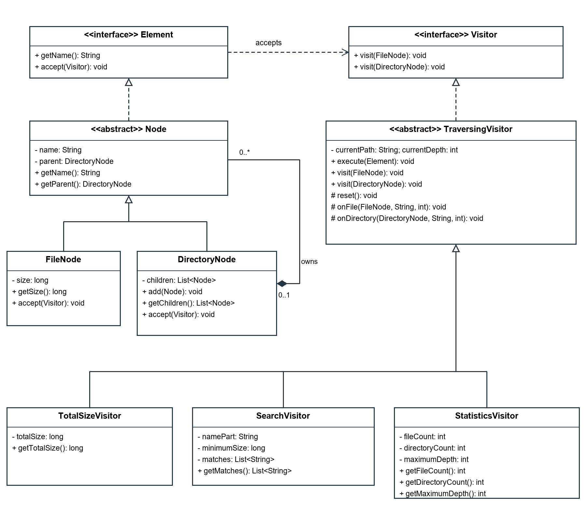
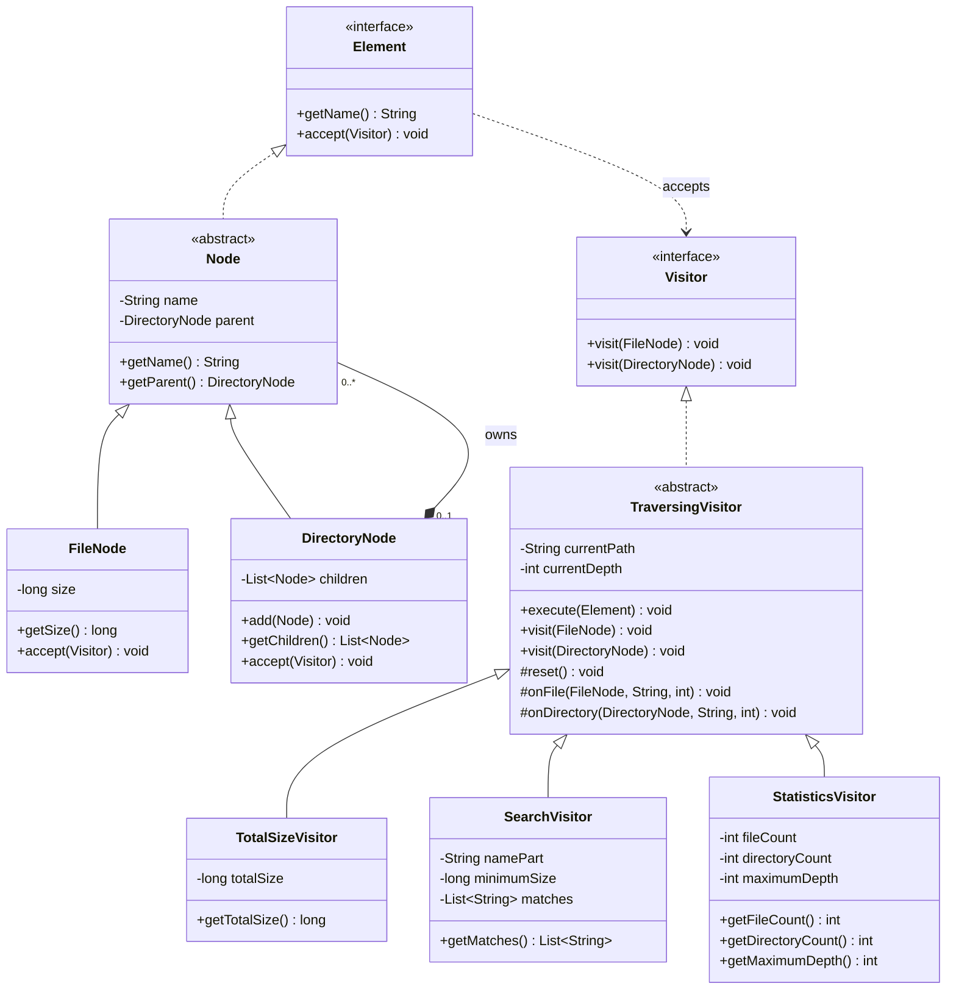

# SDP_assignment6

**Amerkhanova Aruzhan | Software Design Patterns | Assignment 06**

A small Java 17 Maven project implementing Visitor over an in-memory file tree.
It calculates total size, searches filenames, and collects statistics without putting
these operations in the element classes. No files on your computer are modified by the application.

## Open and run in IntelliJ IDEA

1. Open this project's `pom.xml` and select **Open as Project**.
2. Set **Project SDK** and **Maven Runner JRE** to **JDK 17**.
3. Reload the Maven project to download JUnit and build plugins.
4. Open `src/main/java/aitu/visitor/Main.java` and run `Main.main()`.
5. To run all tests, open the Maven tool window and run **Lifecycle > test**.

## Run from a terminal

Requirements: JDK 17 and Maven 3.9.x. Set `JAVA_HOME` to the JDK directory and
put Java and Maven's `bin` directories on `PATH`. Internet is needed for the first
dependency download. No IntelliJ configuration or keyboard input is needed.

From the project root:

```sh
mvn test
mvn package
java -jar target/SDP_assignment6-1.0.jar
```

`mvn package` also runs the tests. On Windows, if `mvn` is not recognized,
use IntelliJ's Maven tool window or add Maven to `PATH`; this is an environment
setting, not a source-code change.

## Project structure

```text
pom.xml
src/main/java/aitu/visitor/   Model, visitor interfaces, visitors, Main
src/test/java/aitu/visitor/   Three JUnit 5 test classes
docs/uml.mmd                 Editable UML source
docs/uml.png                 UML image
README.md                   Run instructions and explanation
```

## Demonstration data and actual output

`Main.createDemoTree()` builds this fixed tree:

```text
study/                         depth 0
|-- readme.txt (120 bytes)      depth 1
|-- notes/                     depth 1
|   |-- lecture.txt (300)       depth 2
|   |-- todo.txt (40)           depth 2
|   `-- archive/               depth 2
|       `-- old.txt (100)       depth 3
|-- images/                    depth 1
|   `-- diagram.png (2048)      depth 2
`-- empty/                     depth 1
```

Actual output from the packaged application:

```text
SDP Assignment 6 - Visitor Pattern
Total size: 2608 bytes
Search: name contains .txt, size >= 100 bytes
  notes/archive/old.txt
  notes/lecture.txt
  readme.txt
Files: 5
Directories (including root): 5
Maximum depth: 3
```

The total is `120 + 300 + 40 + 100 + 2048 = 2608`.
The root and the empty directory count as directories. The deepest file is at depth 3.
`todo.txt` fails the size filter; `diagram.png` fails the filename filter.
`old.txt` matches because the threshold is inclusive.

## Read the code in this order

1. `Element` and `Visitor`: the two contracts.
2. `Node`, `FileNode`, `DirectoryNode`: the tree and its integrity checks.
3. `TraversingVisitor`: the only owner of traversal.
4. `TotalSizeVisitor`, `SearchVisitor`, `StatisticsVisitor`: the three operations.
5. `Main` and the tests: concrete examples of using these classes.

## Double dispatch in two steps

For `Element element = new FileNode("a.txt", 12)`:

1. `element.accept(visitor)` dynamically selects `FileNode.accept`.
2. Inside that method, `this` has the compile-time type `FileNode`, so
   `visitor.visit(this)` selects the `visit(FileNode)` overload. Java then dispatches
   that method on the actual visitor object. `DirectoryNode` selects its own overload.

Our operation visitors inherit the final overloaded methods from `TraversingVisitor`;
those methods call the operation's overridden hooks. No runtime type tests or casts
select between files and directories. `DoubleDispatchTest` verifies both overloads
using a recording visitor and an `Element` reference.

## Algorithms step by step

### Tree insertion

`DirectoryNode.add(child)` rejects null, an existing parent, an ancestor/self cycle,
and a duplicate sibling name. It checks the receiving directory's parent chain by
object identity, without checking node types. Only after every check passes does it
add the child and set its parent. A failed insertion leaves the tree unchanged.
Names are immutable and case-sensitive. They cannot be blank, `.` or `..`, or contain
`/` or `\`. File sizes are immutable, non-negative `long` values. There is no removal,
rename or public parent setter. `getChildren()` exposes an unmodifiable view.

### One depth-first traversal

1. `execute(root)` clears the operation's state, sets path to empty and depth to 0.
2. The root accepts the visitor. A file triggers `onFile` once.
3. A directory triggers `onDirectory` once, then visits each child in insertion order.
4. Each child path is the parent path plus `/` and the child's name; depth increases by 1.
5. The parent's path and depth are restored when traversal returns.

The elements' `accept` methods never traverse. Thus no node is visited twice by an
operation. Visitors share the traversal code instead of duplicating recursion.

### Total size, search and statistics

- **Total size:** start at zero, add each file's size once. Directories add no bytes.
  `Math.addExact` throws `ArithmeticException` if a sum exceeds `long` capacity.
- **Search:** accept a file only if its name contains `namePart` AND its size is at least
  `minimumSize`. Matching is case-sensitive and checks the filename, not directory names.
  Empty search text matches all filenames; negative thresholds and null text are rejected.
  `getMatches()` returns an immutable, lexicographically sorted snapshot.
- **Statistics:** count each file and directory, updating the maximum depth for both.
  An empty root directory gives `(0 files, 1 directory, depth 0)`.

Paths are relative to the root passed to `execute`, even if that node has a parent.
The root directory's name is omitted and `/` is always used. A root that is itself
a file is represented by its filename and has depth 0. All nodes, including empty
directories, contribute to depth. A filename match never returns a directory.

### State and limits

All visitors are reusable: call `execute(root)` for every complete operation, then
read the getters. Direct `accept`/`visit` calls are dispatch primitives, not reset-and-run
operations. Reusing a visitor or changing the order of operations does not accumulate
old results. Getters describe the latest successful run; after a failed traversal,
call `execute` again before reading results. Instances are not thread-safe, and the
tree must not be mutated during traversal.

The recursive implementation supports arbitrary tree shapes within JVM stack and
memory limits. Extremely deep trees would need an explicit stack. Traversal visits
N nodes in O(N) steps; building path strings adds their lengths. Sorting K search
results costs O(K log K) comparisons. The recursion uses O(depth) stack frames.

## Extension boundary and trade-offs

To add an operation, extend `TraversingVisitor`, implement `reset` and `onFile`, and
override `onDirectory` when needed. No element or `accept` changes are needed.
Commit `7637454` adds `StatisticsVisitor` and tests after the first two visitors;
`FileNode`, `DirectoryNode`, `Element` and `Visitor` stay unchanged.

Adding a new **element type** is harder: add its `accept`, a new overload to `Visitor`,
and support in every direct visitor implementation (including traversal). Existing
operations must decide how the new type contributes. Visitor suits a stable element
hierarchy with changing operations. Read-only getters expose the data operations need,
but writable child collections and parent changes remain hidden.

## Verification and requirement map

Verified on JDK 17 with `mvn test package`: **23 tests, 0 failures, 0 errors, 0 skipped**.

| Test class | Tests | Main checkpoints |
| --- | ---: | --- |
| DoubleDispatchTest | 2 | T1: correct overload; accept does not recurse |
| VisitorsTest | 14 | T2-T7: size, combined filters, paths, statistics, empty results, reruns |
| TreeIntegrityTest | 7 | T8: negative size, names, ownership, cycles, immutable children |

Tests also cover a single file root, selected subtrees, the exact size boundary,
case sensitivity, saved result snapshots, overflow recovery, and unchanged state
after rejected mutations. Test data is separate from demonstration data.

| Requirement | Implementation evidence |
| --- | --- |
| R1 | Element, FileNode, DirectoryNode; nested children |
| R2 | Concrete accept methods and both Visitor overloads |
| R3 | TotalSizeVisitor.onFile |
| R4 | SearchVisitor.onFile and getMatches |
| R5 | StatisticsVisitor hooks; root depth zero |
| R6 | Node constructor, FileNode constructor, DirectoryNode.add |
| R7 | TraversingVisitor is the sole traversal owner |
| R8 | Separate statistics commit with unchanged elements |

## UML



Editable Mermaid version:



## Practice for the defense

- Trace `execute -> accept -> visit -> onFile` for `notes/archive/old.txt`.
- Explain why `visit(FileNode)` is chosen without `instanceof`.
- Change the threshold in `Main` from 100 to 200: only `notes/lecture.txt` should match.
- Change `todo.txt` from 40 to 150 bytes: total becomes 2718 and it joins the matches.
- Explain why the empty root is one directory, but a root file is zero directories.
- Run `mvn test` and explain the inclusive-boundary and rejected-cycle assertions.
- Explain why adding an operation is easier than adding an element type.

## Sources and assistance

Course materials: Almas Ospanov, Lecture 9, Visitor Pattern and Clean Code;
Assignment 06, Visitor Pattern - Advanced File System (R1-R8 and T1-T8).
AI assistance (OpenAI Codex) was used to prepare this implementation, tests and
documentation. Review the code and follow the course's individual-work rules before submission.
The separate Word report is not stored in this repository.
